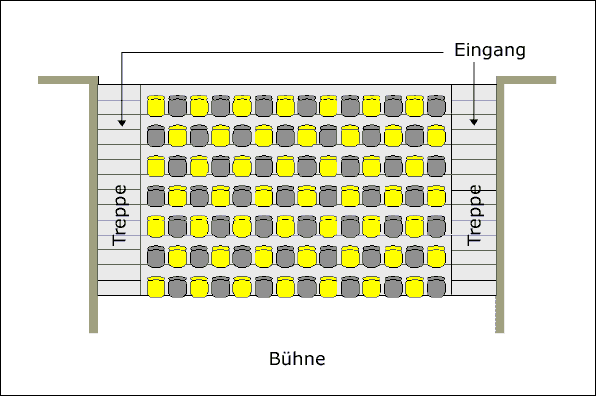

Unsere Heimatbühne ist das heimelige Kleintheater im Schulhaus Steinboden in Eglisau. Rund 100 Plätze bietet es an. Die Zuschauer sitzen auf bequemen Schalensitzen und haben garantiert freie Sicht von jedem Platz da jede Reihe gegenüber der vorderen höher liegt. Bei uns gibt’s keine „schlechten“ Plätze.

In der vordersten Reihe sind Sie mittendrin im Geschehen, da Sie quasi auf der Bühne sitzen. Aber bis zur hintersten Reihe geniessen Sie volle Sicht auf die Bühne – und zwar von schräg oben. Damit sind wir das einzige dreidimensionale Theater im Zürcher Unterland.

