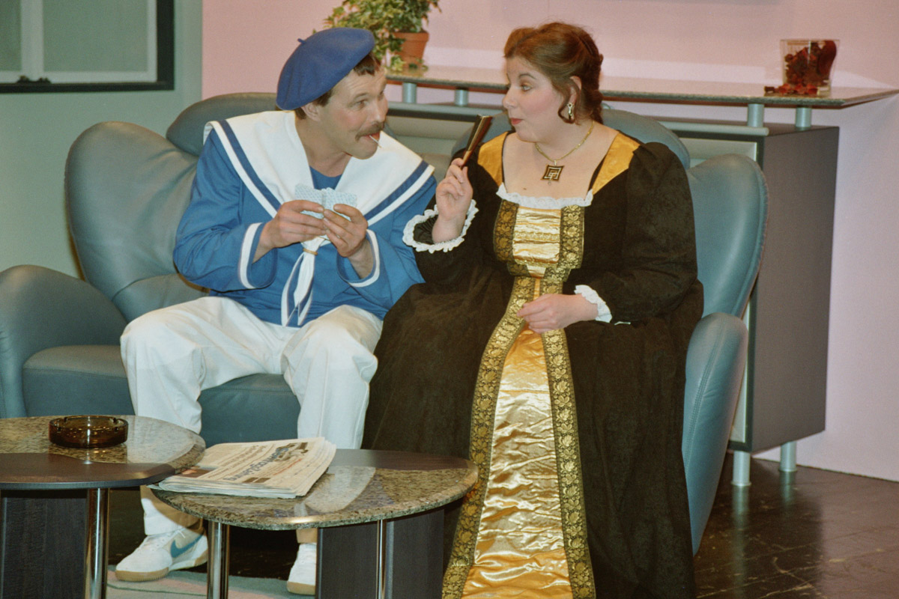
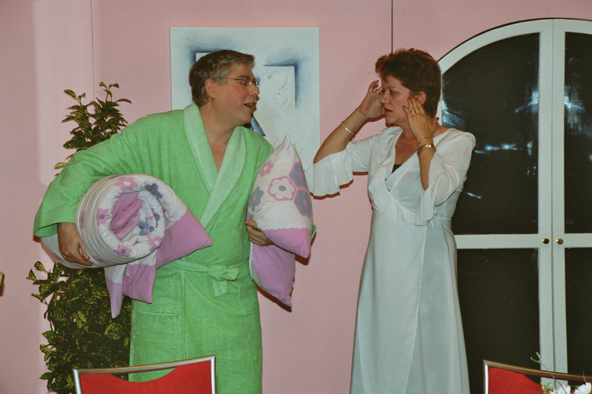
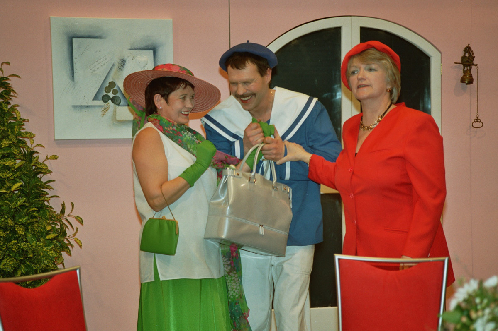
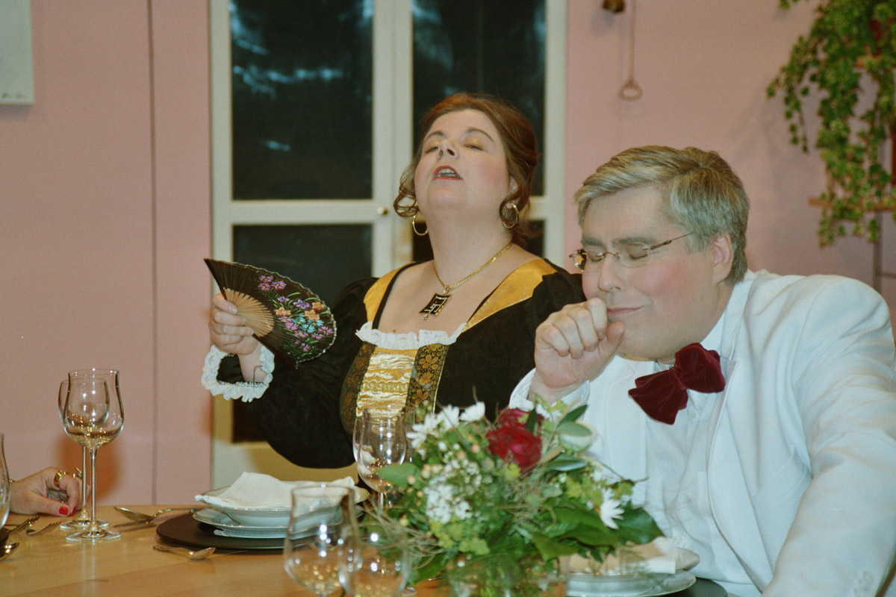
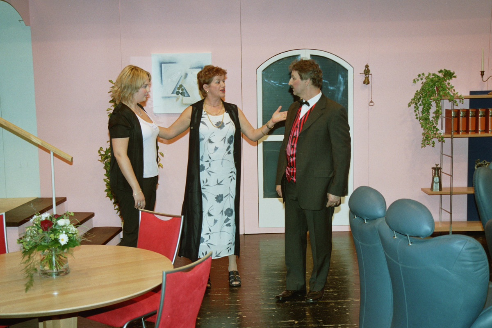
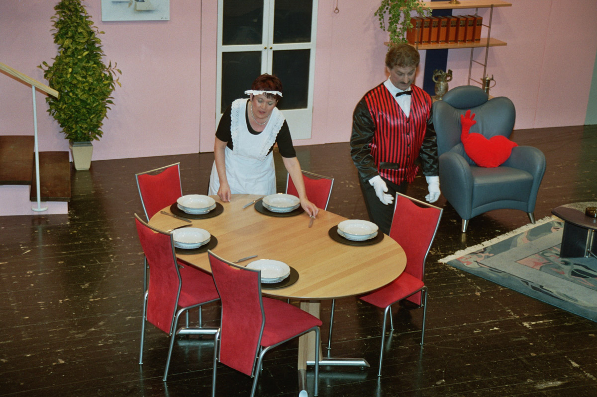

## Blaus Bluet und Erbslisuppe (2005)

**Schwank in drei Aktien von Dieter Adam, Dialektfassung Barbara Albisser, Regie: Willi Sutter**

Frau Neumann möchte Ihre Tochter „standesgemäss“, das heisst mit möglichst reinem „blauem Blut“ verheiraten. Um sich vor dem Zukünftigen und dessen Mama nicht zu blamieren, wird ein Butler engagiert, der den Neumanns im Schnellkurs Manieren beibringen soll. Herr Neumann, der am liebsten Erbsensuppe isst, findet die ganze Sache lächerlich und auch die Tochter Betty tut sich schwer mit den mütterlichen Plänen.

-   

-   

-   

-   

-   

-   
