## Chrampf im Altersheim (2009)

**Lustspiel in drei Akten von Bernd Gormbold, Dialektübersetzung: Vroni Schnetzer,
Regie: Christine Lamprecht**

**„Hät e alte Mänsch nüd au s’rächt uf frischi Luft?“**

Der Heimleiter des Altersheimes versucht mit Strafmassnahmen die Senioren einzuschüchtern und so für Ruhe und Disziplin zu sorgen. Fred Müller, sein „verwirrter“ Zimmernachbar Paul und die schwerhörige Irma wollen jedoch nicht kuschen. Maria, die quirlige italienische Putzfrau, hilft den Heimbewohnern. Probleme hat Fred auch mit seinem krankhaft geizigen Sohn Hermann und dessen Frau Gisela. Ihre alleinige Sorge ist, dass der alte Herr immer noch kein Testament gemacht hat. Einzig in seiner Enkeltochter Karin hat Fred eine treue und hilfreiche Verbündete, die ihn unterstützt. Karin findet in ihrem Grosstädi einen treuen Ratgeber, der ihr bei Problemen mit List und Tücken zur Seite steht. Als Karins Freund Steff in eine Schlägerei verwickelt wird, versteckt ihn Opa Müller kurzerhand im Altersheim. Mitten in diese missliche Situation platzt nun auch noch sein zweiter Sohn, der Möchtegern-Macho Johnny, der seit 12 Jahren verschollen war. Auch er will an Freds Geld. Aber Fred ist einfach zu clever.

## **Personen, Darsteller, Mitwirkende:**

-   Fred Müller (Severin Lamprecht)
-   Hermann, Sohn von Fred (Klaus Holzhauer)
-   Gisela, Frau von Hermann (Monika Wirth)
-   Karin, Enkelin von Fred (Monika Spühler)
-   Steff, Freund von Karin (Christoph Mühlemann)
-   Johnny, 2. Sohn von Fred (Urs Heller)
-   Herr Eckert, Heimleiter (Armin Stampa)
-   Maria, Heimangestellte (Katharina Altenburger)
-   Paul, Altersheimbewohner (Walter Schibli)
-   Irma, Altersheimbewohnerin (Silvia Zwinggi)
-   Bea, Heimservice (Silvia Kramer)

-   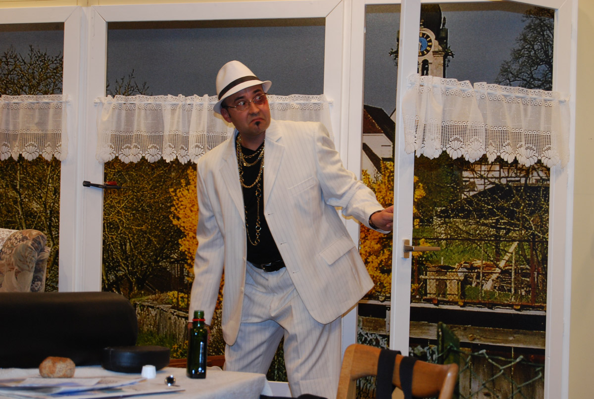

-   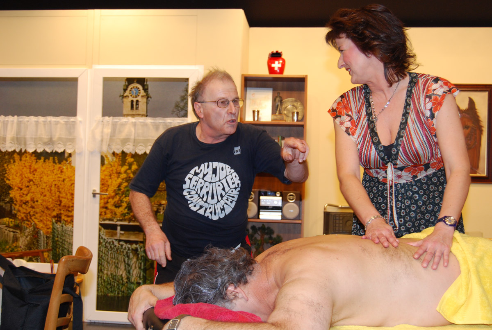

-   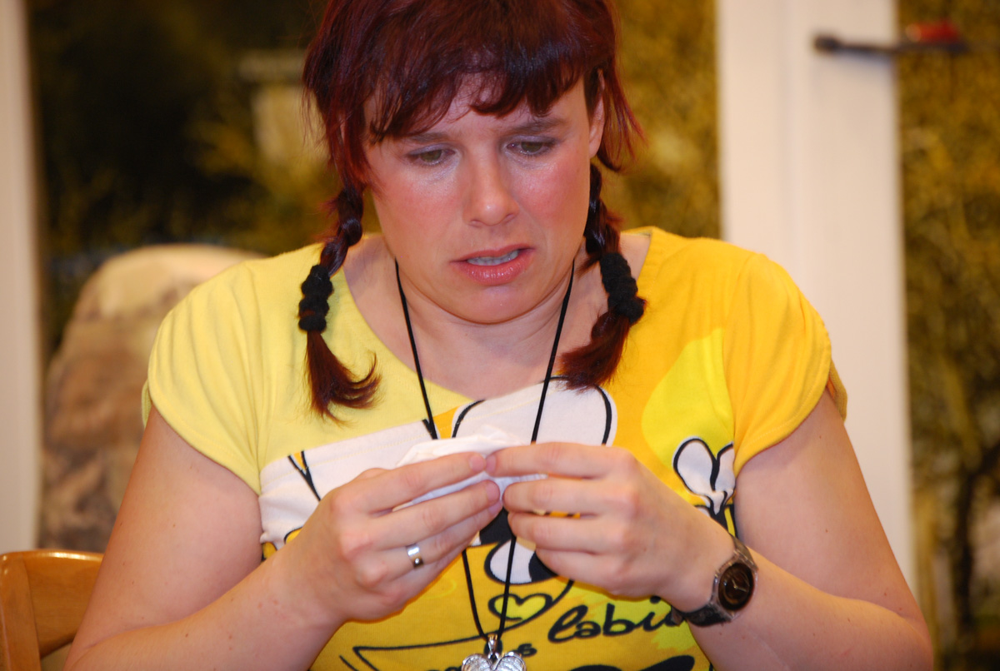

-   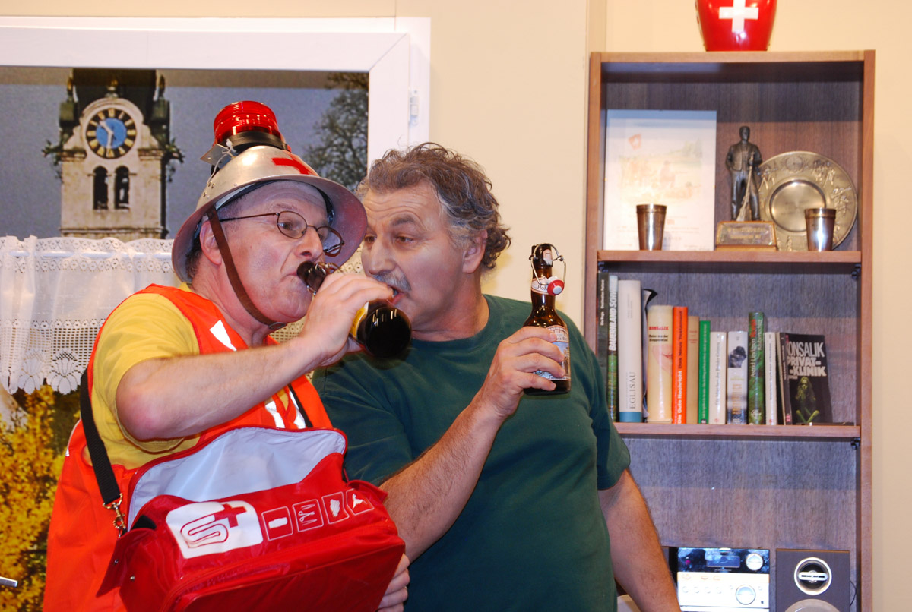

-   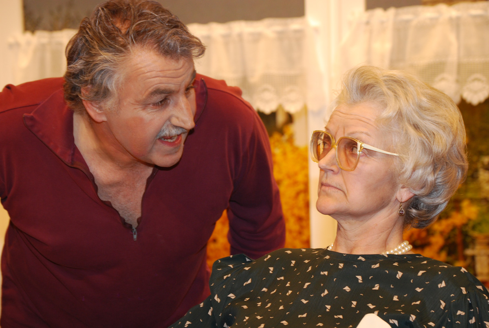

-   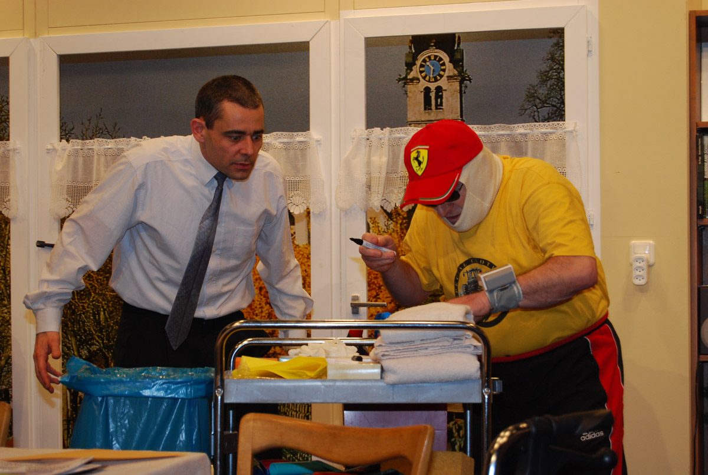

-   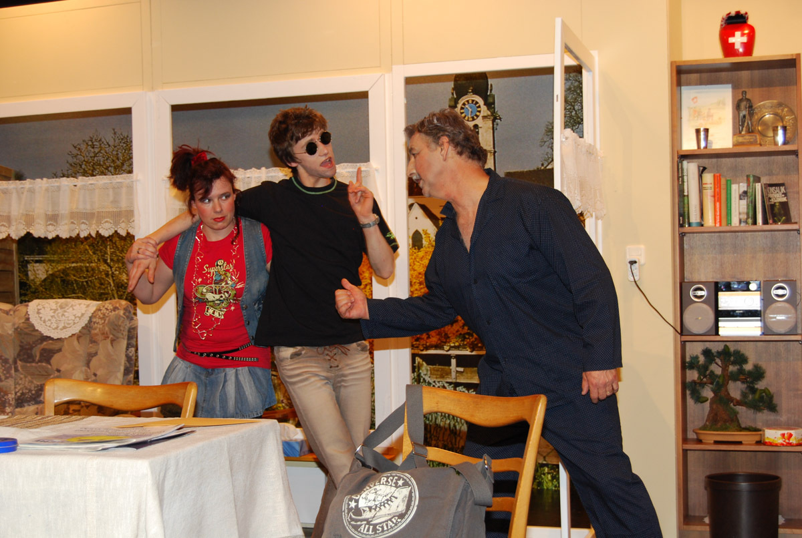

-   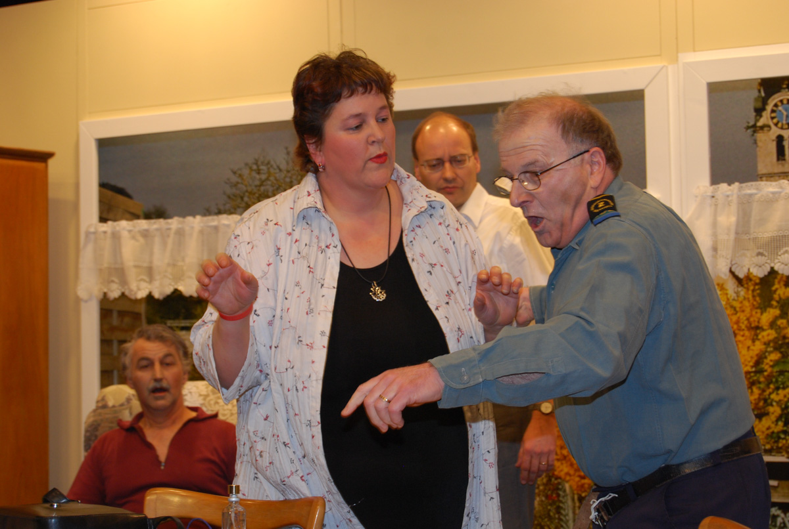

-   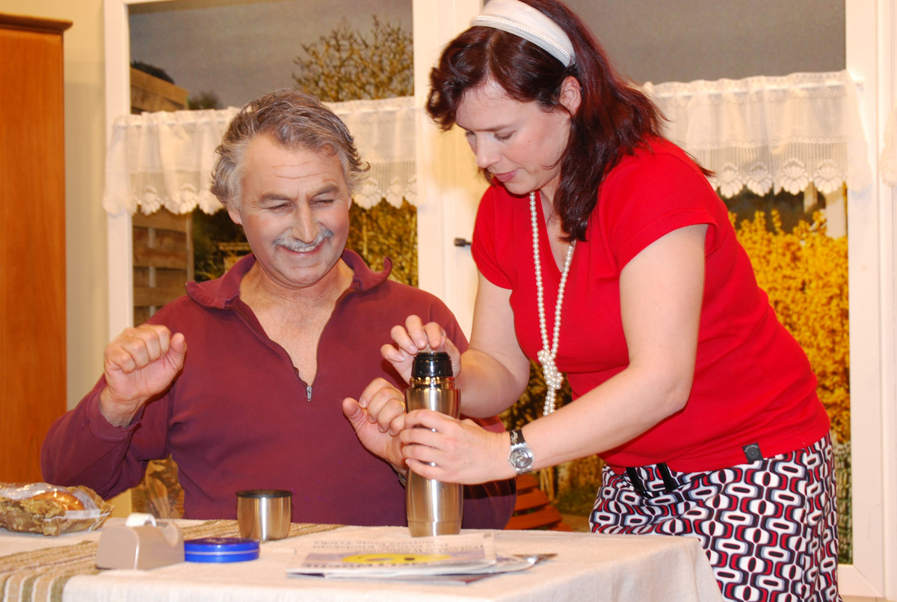

-   

-   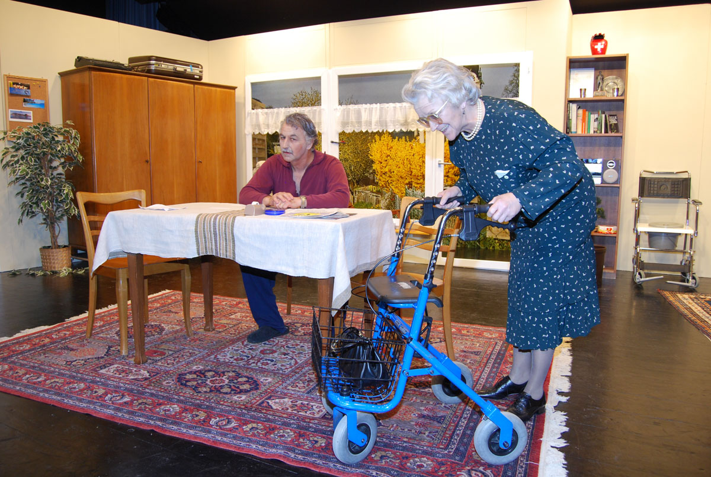

-   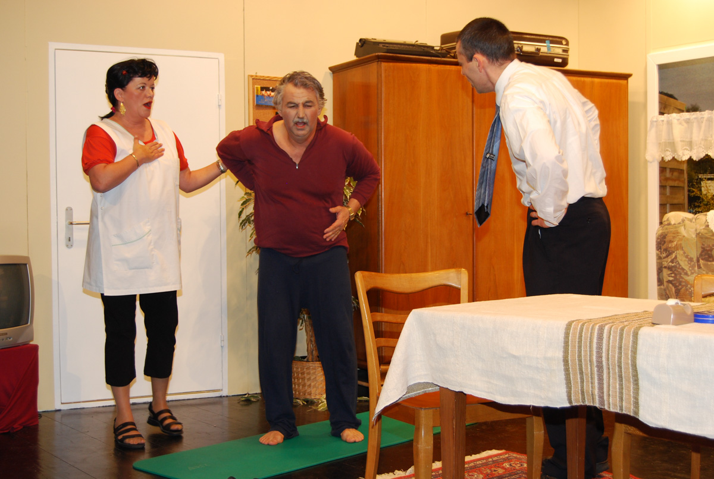
