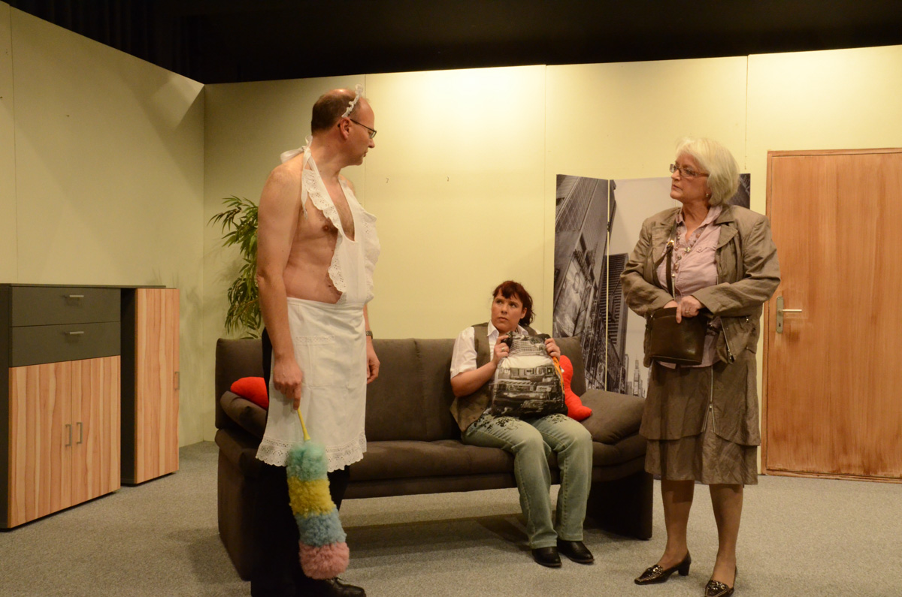

## WG wider Willen (2012)

**Lustspiel in drei Akten von Marcel Schlegel**

Rainer und Heidi sind einander völlig unbekannt, finden sich aber plötzlich in ein und derselben Wohnung wieder. Sie sind auf eine zwielichtige Wohnungsvermieterin hereingefallen und haben nun je einen „gültigen“ Mietvertrag in den Händen. Beide wollen die Wohnung behalten, beide wollen alleiniger Mieter sein. Wer muss ausziehen… wer darf bleiben? Rainer, der sattelfeste Junggeselle oder die grundsatztreue Heidi mit Mutter und bester Freundin Nolly im Schlepptau?

Fetzige Wortgefechte und raffinierte Intrigen geben sich die Hand. „WG wider Willen“, ein köstliches Vergnügen mit ausnehmend starker Frauenbesetzung.

## Darsteller:

| Rainer Camenzind | Klaus Holtzhauer |
| --- | --- |
| Heidi Schillinger | Monika Spühler |
| Mutter Schillinger | Silvia Zwinggi |
| Nolly | Katharina Altenburger |
| Eva | Nicole Antener |
| Roberto Gander | Walter Schibli |
| Sommicano | Christine Missàk |

## Hinter der Bühne:

| Regie | Hansjörg Lutz |
| --- | --- |
| Souffleuse | Monika Wirth |
| Requisiten | Johanna Hitz |
| Maske | Claudia Rieser |
| Maske | Linda Wüthrich |
| Licht/Ton | Patrick Schibli |
| Bühne | Patrick Zimmermann |
| Theaterbeiz | Remy & Stefan Lauffer |
| Kasse | Esther Gubser-Kodagoda |

-   

-   

-   

-   

-   

-   

-   

-   

-   

-   
