## „Alles uf Chrankeschii“ (2013)

Heute ist Dr. Leus grosser Tag: eine Rede vor Kollegen, ein beruflicher Aufstieg, und er soll zum Chefarzt befördert werden.

Doch dann kommt alles anders: plötzlich taucht seine ehemalige Geliebte Rita auf und hat eine Überraschung parat: einen Sohn! Dieser stellt auf der Suche nach seinem Vater das ganze Krankenhaus auf den Kopf.

Dr. Leu versucht verzweifelt, alles vor seiner Frau, dem Polizisten und den Kollegen zu verheimlichen. Und schon herrscht das Chaos im Ärztezimmer: als Oberschwester verkleidete Ärzte, ein betrunkener Sohn, ein ziemlich irritierter Polizist und ein etwas trotteliger Patient machen das Durcheinander perfekt. Und wer ist denn nun eigentlich der Vater?

Es wird gelogen, dass sich die Balken biegen.
Irrwitzige und turbulente Situationen – … alles auf Krankenschein!

## Rollen und ihre Darsteller:

| Dr. med Leo Leu | Klaus Holzhauer |
| --- | --- |
| Rosmarie Leu | Katharina Altenburger |
| Dr. med. Balthasar Beckmann | Armin Stampa |
| Eveline Vögeli | Monika Wirth |
| Gertrud | Silvia Zwinggi |
| Dr. Prof. Amalie Hofstetter | Moni Spühler |
| Rita Kuster | Silvia Kramer |
| Felix Kuster | Nino Accardi / Johannes |
| Franz Felix | Alphons Müller |
| Fritz Vögeli | Walter Schibli |

## Hinter der Bühne:

| Regie | Hansjörg Lutz |
| --- | --- |
| Souffleusen | Esther Hangartner / Johanna Hitz |
| Requisiten | Johanna Hitz |
| Maske | Claudia Rieser / Linda Wüthrich |
| Licht/Ton | Patrick Schibli |
| Bühnenmeister | Werner Zimmermann |
| Theaterbeiz | Remy & Stefan Lauffer |
| Kasse | Esther & Yasa Gubser-Kodagoda |

-   

-   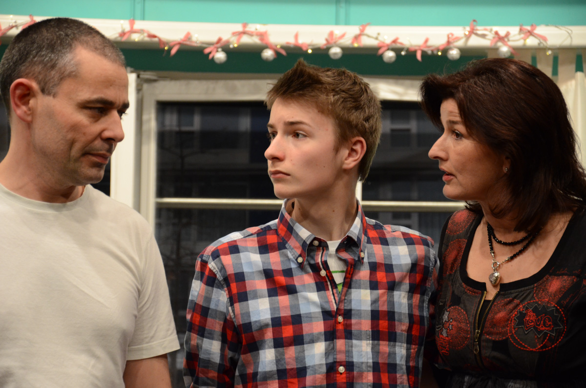

-   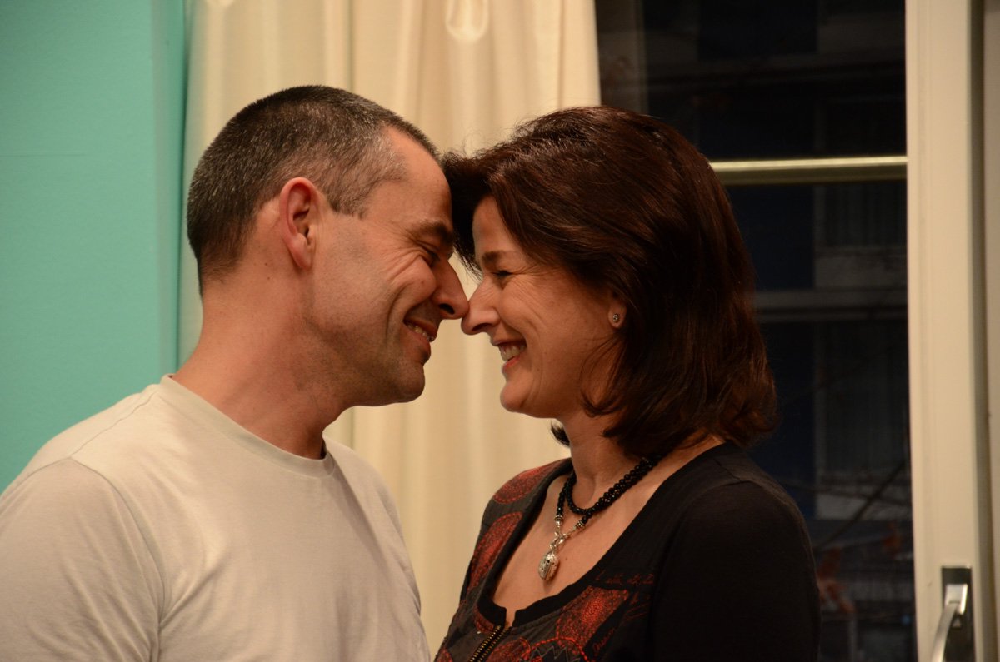

-   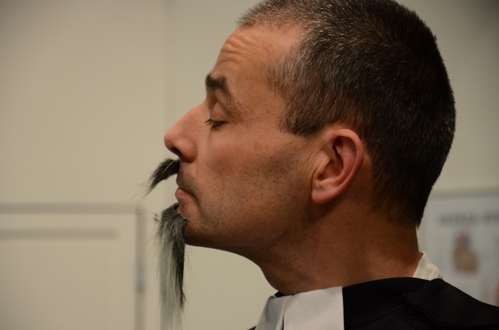

-   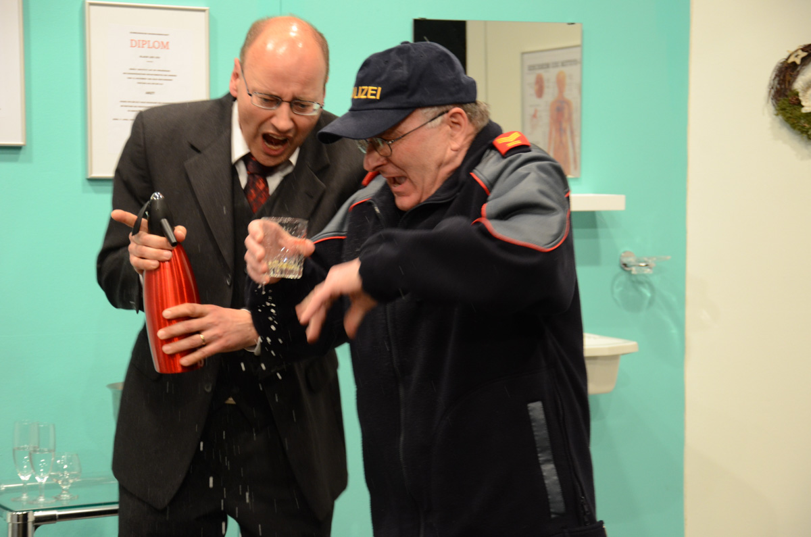

-   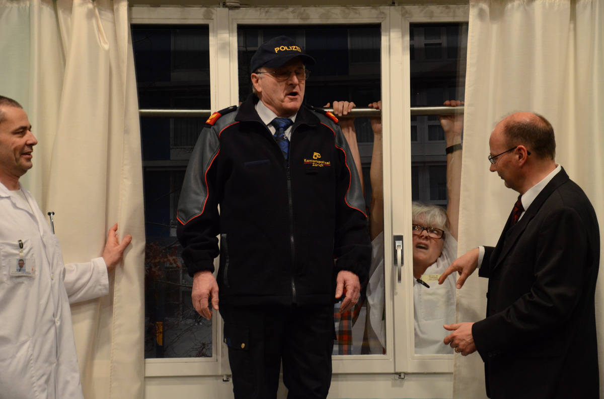

-   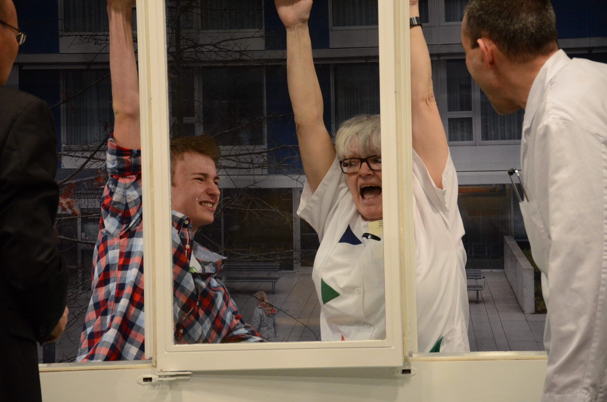

-   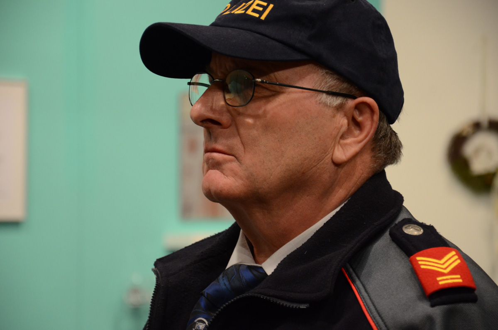

-   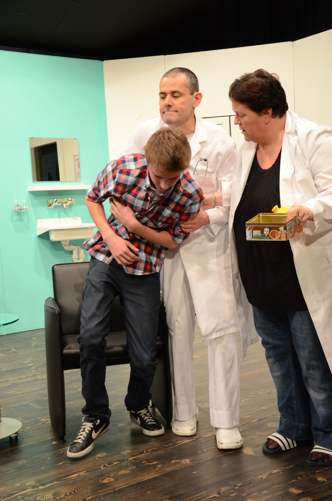

-   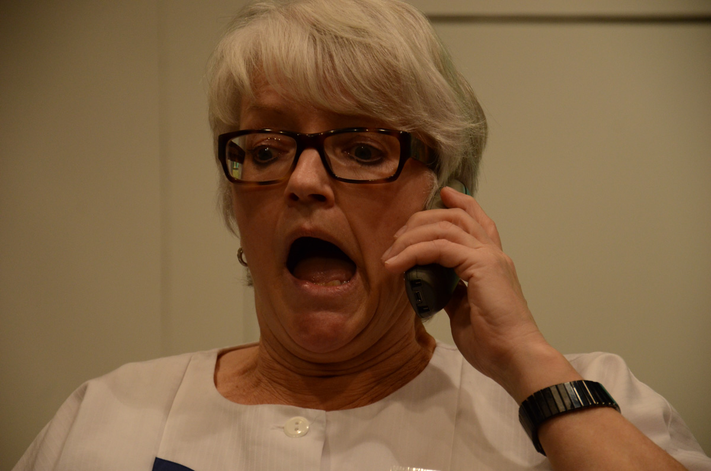

-   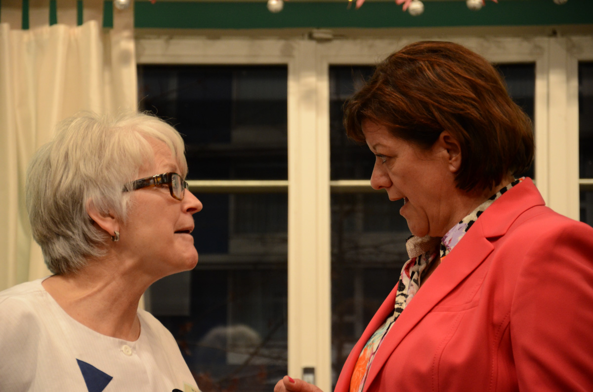

-   

-   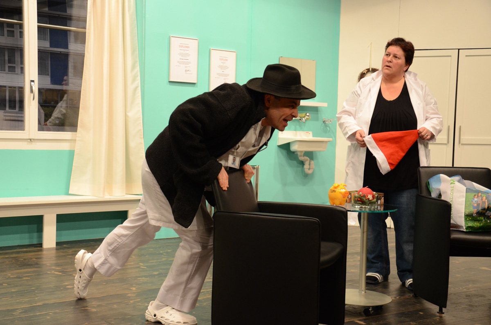

-   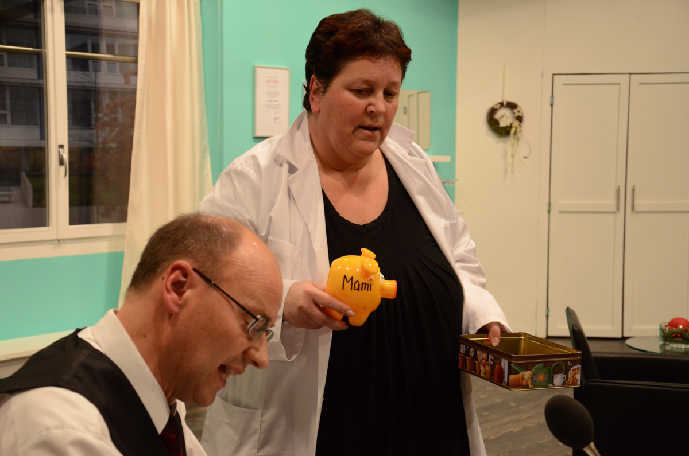
